# NB SelfCare Mobile

<p align="center">
  
</p>

<p align="center">
  <strong>Autocuidado diario en tu teléfono. Tu comida, tu cuerpo, tu cuidado y tu ayuno en un solo lugar, y en ningún otro.</strong>
</p>

<p align="center">
  <a href="LICENSE"></a>
  
  
  
  
</p>

<p align="center">
  <a href="README.md">English</a> · <strong>Español</strong>
</p>

---

## En pocas palabras

NB SelfCare Mobile es una app de autocuidado libre y de código abierto. Reúne lo que normalmente reparten varias
apps de pago: comida y minerales, peso y composición corporal (con lectura directa de la Xiaomi Mi Scale 2), gasto
diario que se ajusta solo, ayuno, sueño, medicamentos, hábitos, suelo pélvico, pausas activas, signos vitales,
síntomas, chequeos preventivos, contadores para dejar hábitos, diario y **Nibi**, un dragón que te acompaña sin
hacerte sentir culpa nunca. Todo se queda en tu teléfono: sin cuentas, sin nube y sin telemetría. Forma parte de la
suite comunitaria de NB Digital, con licencia Apache 2.0.

## Qué hace

| Área | Qué tienes |
|---|---|
| **Inicio** | Disposición del día (sueño, pulso, carga), tablero de tarjetas que ordenas y redimensionas, diario con ánimo, energía y estrés, y revisión del domingo |
| **Comida** | Catálogo sin conexión, escáner de códigos con Open Food Facts, escribir o dictar comidas, combos, recetas, menú sugerido, balance, macros, minerales, grado NOVA y agua |
| **Cuerpo** | Báscula Xiaomi Mi Scale 2 por Bluetooth con 13 métricas, peso a mano, cinta métrica, tendencia, detector de falsa subida, metas intermedias, evolución y entrenamientos en segundos |
| **Cuidado** | Medicamentos y suplementos con reserva y avisos discretos, hábitos propios, suelo pélvico guiado, pausas activas, signos vitales, síntomas, chequeos preventivos, alcohol y tabaco, y **Libre**, contadores para dejar hábitos sin culpa |
| **Ayuno** | Protocolos, fases metabólicas, avisos de seguridad y cronómetro en la pantalla de bloqueo que no gasta batería (Android) |
| **Nibi** | Un dragón dibujado en código que refleja tus hábitos, monedas, escudos de racha, tienda, armario y respiración guiada |
| **Perfil** | Gasto diario que se ajusta cada 14 días, protocolo semanal, ciclo menstrual, patrones entre hábitos e informe PDF |
| **Personalización** | 24 temas, cuatro de aspecto papel, e ícono de la app por tema (Android) |
| **Idiomas** | Español, inglés y portugués |

## Garantías de privacidad

Estas garantías las hacen cumplir el código y comprobaciones automáticas; la declaración completa está en
[PRIVACY.md](PRIVACY.md) y en [privacidad](docs/audit/privacy.md).

* **Cero telemetría y cero registros.** Sin analítica, sin informes de fallos, sin seguimiento de uso, sin archivos
  de registro.
* **Una sola puerta de red.** Toda conexión se construye en `lib/core/network/`: Open Food Facts, cuando escaneas
  un código desconocido o lo buscas; GitHub, solo cuando tocas "Buscar actualizaciones" en Android; y tu propio
  ordenador con NB SelfCare, solo tras vincularlo con su código QR, por tu red local y con certificado fijado.
  Cualquier cliente en otro sitio hace fallar las comprobaciones.
* **Sin cuenta y sin nube.** Tus datos viven en un archivo SQLite del teléfono; la copia en la nube de Android está
  desactivada. La copia de seguridad es un archivo `.sqlite` que exportas tú.
* **No es un dispositivo médico.** La bioimpedancia y las fases del ayuno son estimaciones.

## Arquitectura de un vistazo

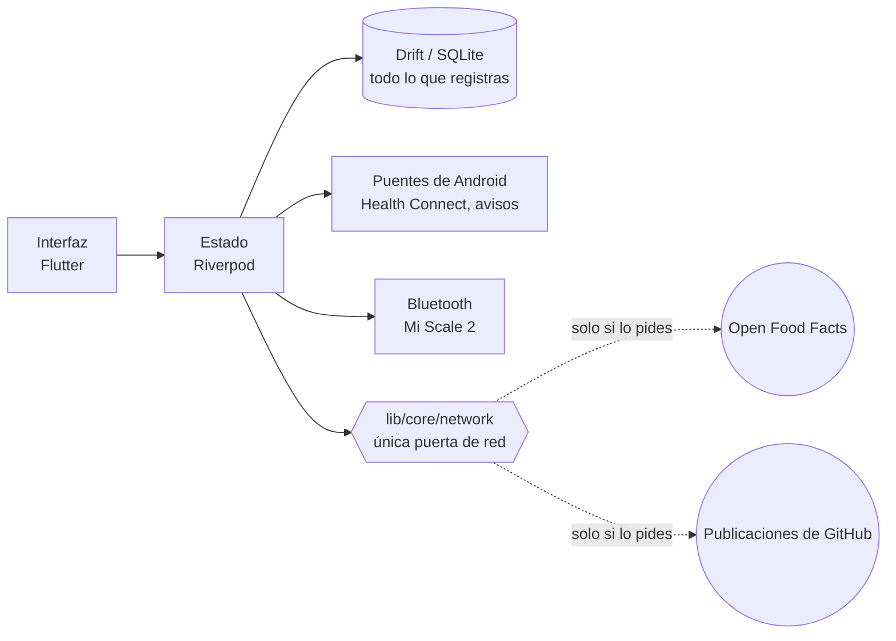

Más detalle en [docs/architecture](docs/architecture/README.md).

## Capturas y video

[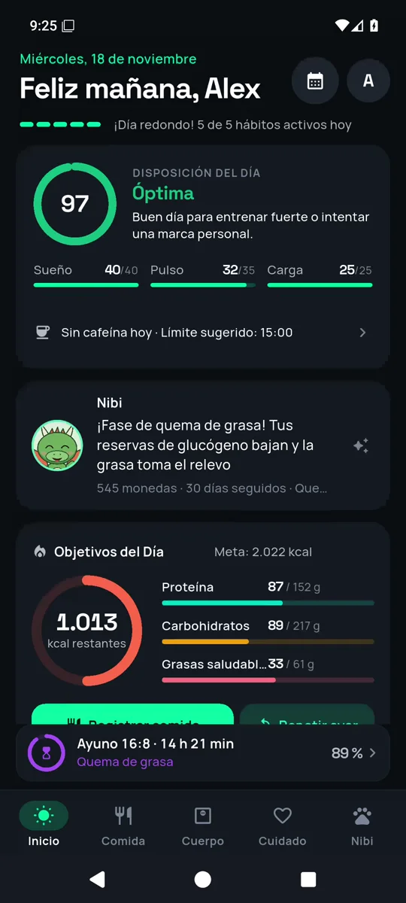](docs/assets/video/nb-selfcare-mobile-demo-es.mp4)

*Un recorrido corto grabado en la propia app ([MP4](docs/assets/video/nb-selfcare-mobile-demo-es.mp4)).*

| Inicio | Comida | Cuerpo |
|---|---|---|
| 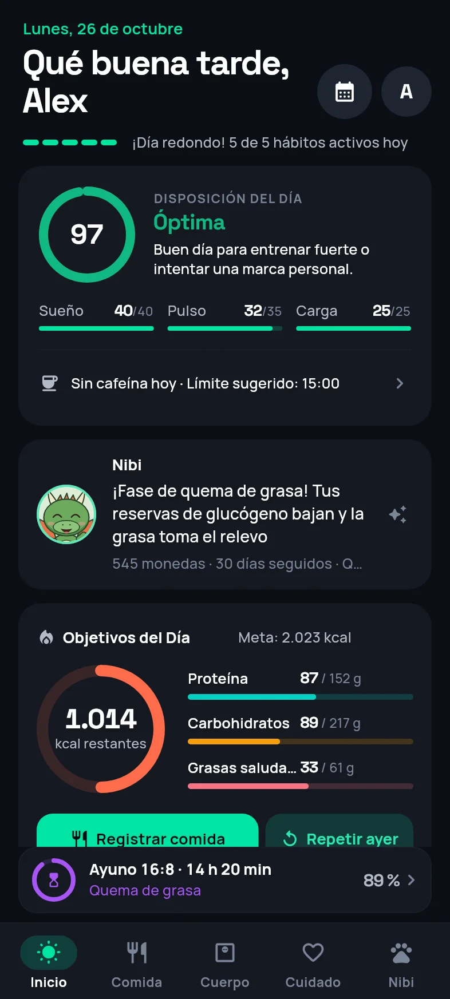 | 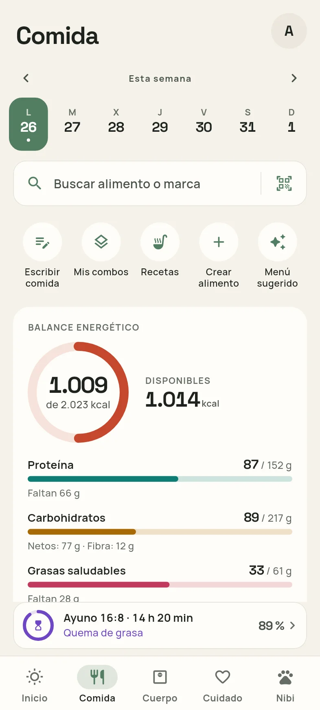 | 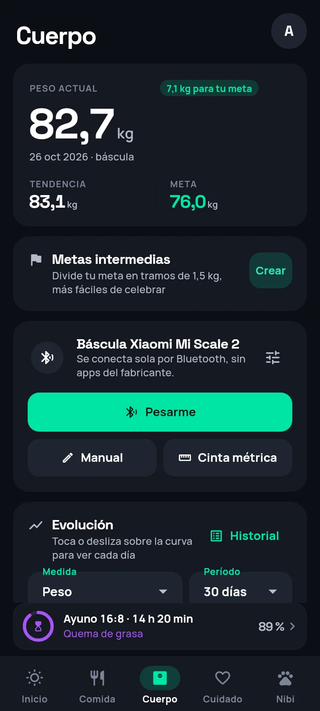 |

| Cuidado | Nibi | Ayuno |
|---|---|---|
| 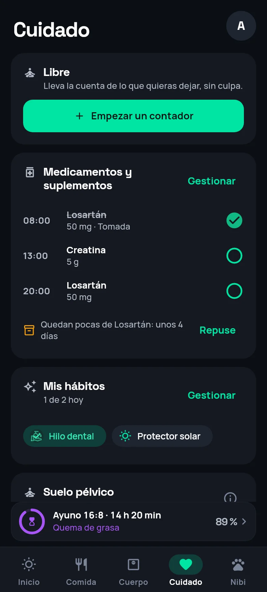 | 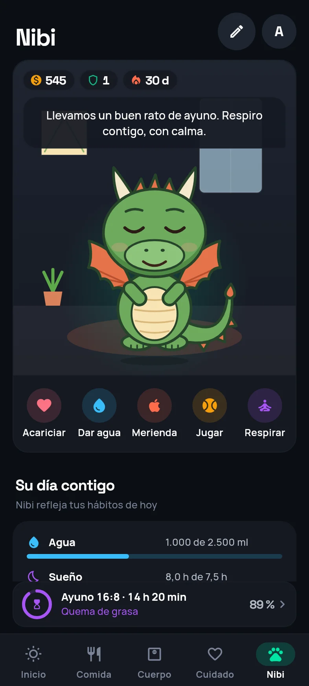 | 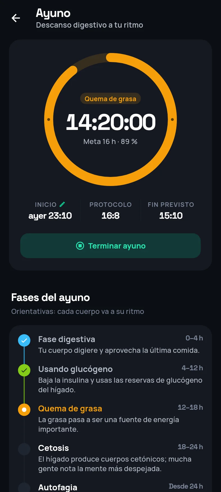 |

| Perfil | Tema de papel | Ajustes |
|---|---|---|
| 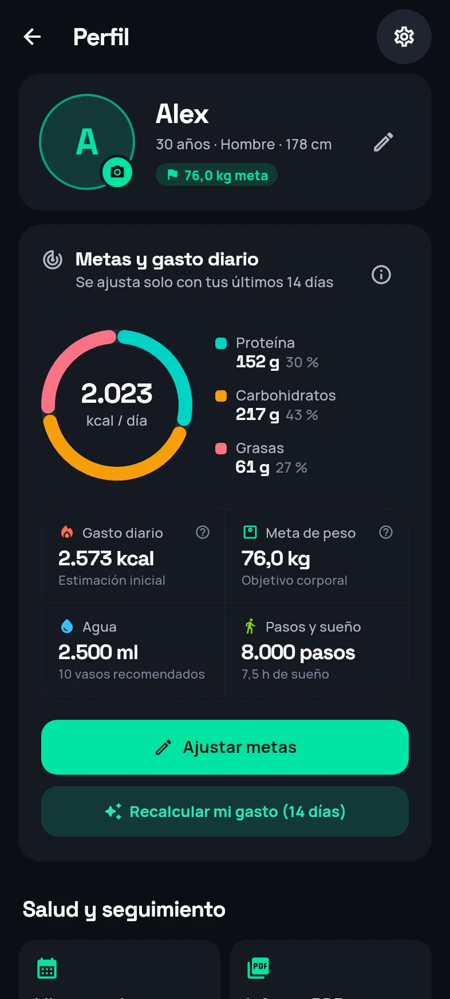 | 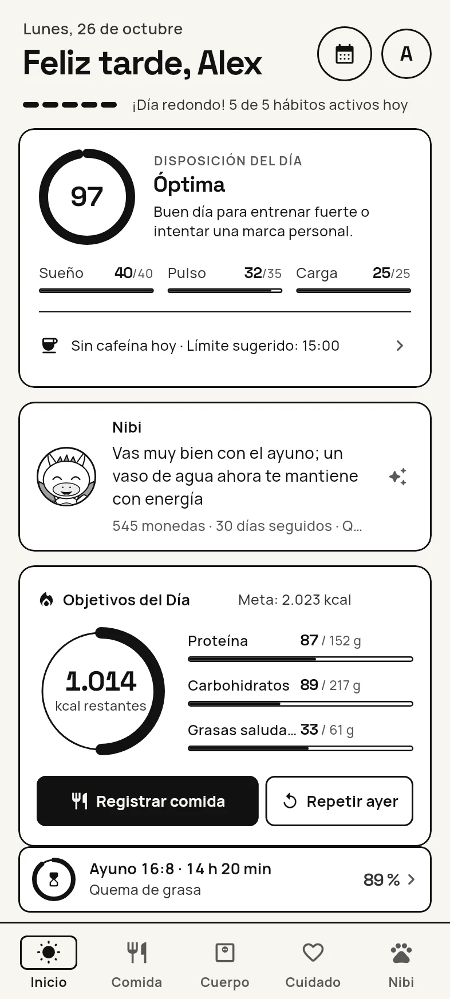 | 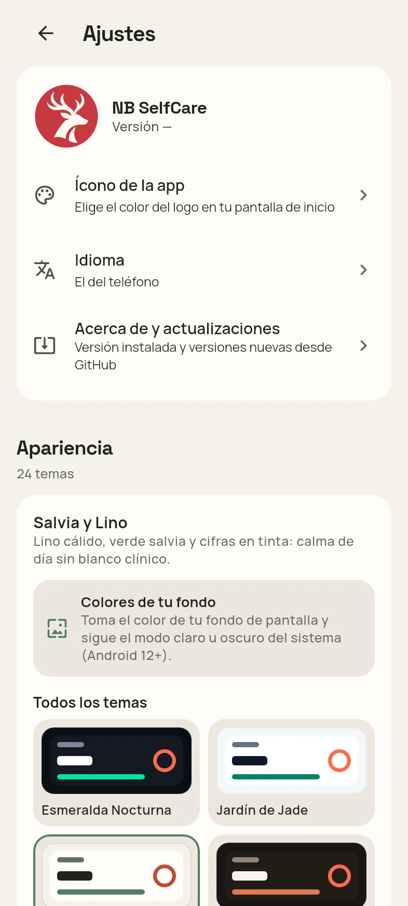 |

El perfil, las comidas, los pesajes, los medicamentos y los registros de estas imágenes son ficticios, creados por
la edición de demostración de la app.

## Instalación rápida

Descarga desde la página de publicaciones y verifica con `SHA256SUMS` y su firma Ed25519 `SHA256SUMS.sig` (ver
[cadena de suministro](docs/audit/supply-chain.md)).

| Dispositivo | Paquete |
|---|---|
| La mayoría de teléfonos Android (64 bits) | `NB-SelfCare-Mobile-1.0.0-arm64-v8a.apk` |
| Teléfonos Android antiguos de 32 bits | `NB-SelfCare-Mobile-1.0.0-armeabi-v7a.apk` |
| Emuladores Android, Chromebooks Intel/AMD | `NB-SelfCare-Mobile-1.0.0-x86_64.apk` |
| Cualquier Android | `NB-SelfCare-Mobile-1.0.0-universal.apk` |
| iPhone y iPad | `NB-SelfCare-Mobile-1.0.0-ios-unsigned.ipa` (**sin probar**) |

Android 8.0 o posterior es la plataforma verificada. Como la app no viene de una tienda, Android avisa antes de
instalarla. La edición de iOS se publica **sin probar en un dispositivo real** y sin firma de Apple: hay que firmarla
para instalarla, e iOS mostrará avisos. Health Connect, los recordatorios programados, el cronómetro en la pantalla
de bloqueo, la vibración guiada, el ícono por tema y el actualizador son solo de Android. Los reportes desde iOS son
bienvenidos.

Para compilar desde el código:

```bash
just setup                                   # dependencias, código de Drift y textos
flutter run --dart-define=NB_DEMO=true       # con el perfil ficticio de demostración
just apk
```

Detalles: [puesta en marcha](docs/developer/setup.md).

## Documentación

| Si quieres… | Lee |
|---|---|
| Usar la aplicación | [Manual de uso](docs/user/README.md) |
| Evaluarla para una institución | [Instituciones](docs/institution/README.md) |
| Entender cómo está construida | [Arquitectura](docs/architecture/README.md) |
| Saber por qué está construida así | [ADR](docs/adr/README.md) |
| Contribuir | [CONTRIBUTING.md](CONTRIBUTING.md) y [guía de desarrollo](docs/developer/README.md) |
| Trabajar en ella con un agente de IA | [AGENTS.md](AGENTS.md) |

## Contribuciones, seguridad y conducta

Las contribuciones son bienvenidas bajo el Developer Certificate of Origin (`git commit -s`); ver
[CONTRIBUTING.md](CONTRIBUTING.md). Las vulnerabilidades se reportan en privado como indica
[SECURITY.md](SECURITY.md). La participación se rige por el [Código de conducta](CODE_OF_CONDUCT.md).

## Licencia y marcas

Apache License 2.0; ver [LICENSE](LICENSE) y [NOTICE](NOTICE). Los nombres "NB", "NB Digital", "NB SelfCare" y "NB
SelfCare Mobile" y sus logotipos no están licenciados bajo Apache 2.0; ver [TRADEMARKS.md](TRADEMARKS.md). Para
citar el proyecto, usa [CITATION.cff](CITATION.cff).
