# NB SelfCare Mobile

<p align="center">
  
</p>

<p align="center">
  <strong>Everyday self-care on your phone. Your food, body, care and fasting in one place, and nowhere else.</strong>
</p>

<p align="center">
  <a href="LICENSE"></a>
  
  
  
  
</p>

<p align="center">
  <strong>English</strong> · <a href="README.es.md">Español</a>
</p>

---

## TL;DR

NB SelfCare Mobile is a free, open-source self-care app. It brings together what usually takes several paid apps:
food and minerals, weight and body composition (including direct reading of the Xiaomi Mi Scale 2), an adaptive
daily calorie target, fasting, sleep, medicines, habits, pelvic floor, active breaks, vital signs, symptoms,
preventive check-ups, counters to quit habits, a journal and **Nibi**, a dragon that keeps you company without ever
making you feel guilty. Everything stays on your phone: no account, no cloud, no telemetry. It is part of the NB
Digital community suite, under the Apache 2.0 licence.

## Features

| Area | What you get |
|---|---|
| **Home** | Today's readiness (sleep, pulse, load), a dashboard of cards you can reorder and resize, a journal with mood, energy and stress, and a Sunday review |
| **Food** | Offline catalogue, barcode scanner with Open Food Facts, write or dictate meals, combos, recipes, suggested menu, energy balance, macros, minerals, NOVA processing level and water |
| **Body** | Xiaomi Mi Scale 2 over Bluetooth with 13 metrics, manual weight, tape measure, trend weight, false-gain detector, milestones, progress chart and workouts in seconds |
| **Care** | Medicines and supplements with supply tracking and discreet reminders, own habits, guided pelvic floor, active breaks, vital signs, symptoms, preventive check-ups, alcohol and tobacco, and **Free**, guilt-free counters to quit habits |
| **Fasting** | Protocols, metabolic phases, safety notices and a lock-screen timer that uses no battery (Android) |
| **Nibi** | A procedural dragon that reflects your habits, coins, streak shields, shop, wardrobe and guided breathing |
| **Profile** | Adaptive daily target every 14 days, weekly plan, menstrual cycle, patterns between habits and a PDF report |
| **Personalisation** | 24 themes, four of them paper-like, and an app icon per theme (Android) |
| **Languages** | English, Spanish and Portuguese |

## Privacy guarantees

These guarantees are enforced by code and by automated checks; the full statement is in [PRIVACY.md](PRIVACY.md).

* **Zero telemetry and zero logs.** No analytics, no crash reporting, no usage tracking, no log files.
* **One network exit.** Every connection is built in `lib/core/network/`: Open Food Facts, when you scan an unknown
  barcode or search it; GitHub, only when you tap "Check for updates" on Android; and your own computer running
  NB SelfCare, only after you link it with its QR code, over your local network with a pinned certificate. Any
  client elsewhere fails the checks.
* **No account, no cloud.** Your data lives in one SQLite file on the phone; Android's cloud backup is disabled.
  Backups are a `.sqlite` file you export yourself.
* **Not a medical device.** Bioimpedance values and fasting phases are estimates.

## Architecture at a glance

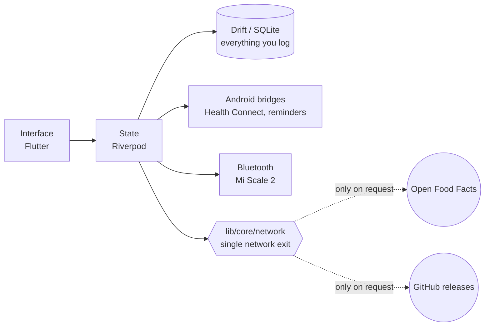

More detail in [docs/architecture](docs/architecture/README.md) (Spanish).

## Screenshots and video

[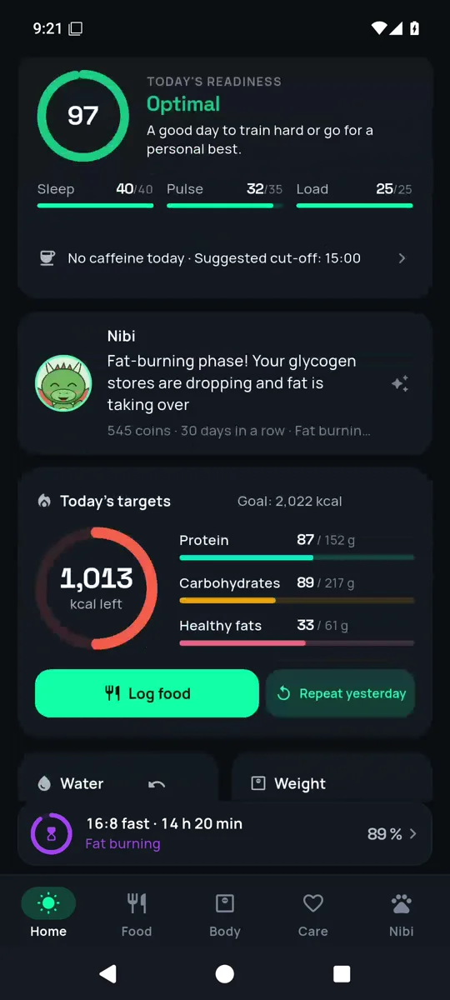](docs/assets/video/nb-selfcare-mobile-demo.mp4)

*A short tour recorded on the app itself ([MP4](docs/assets/video/nb-selfcare-mobile-demo.mp4)).*

| Home | Food | Body |
|---|---|---|
| 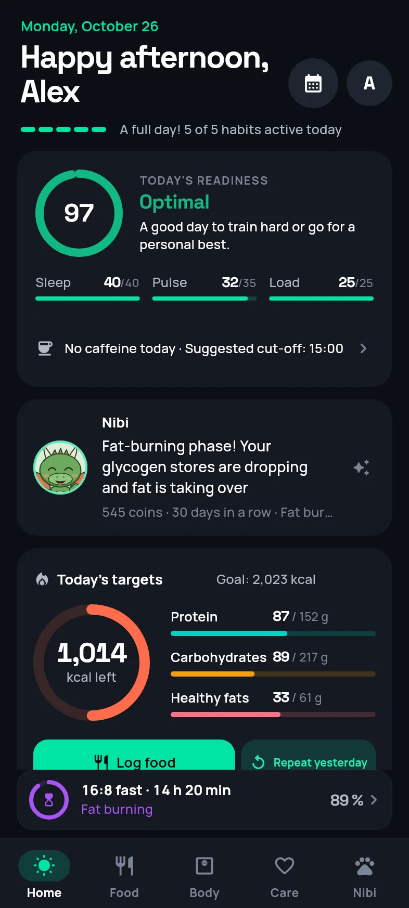 | 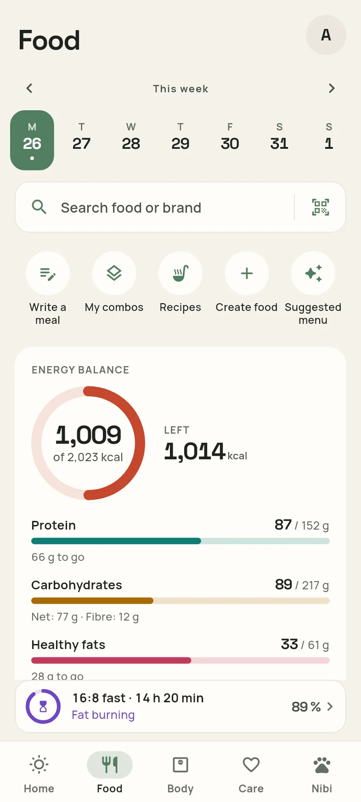 | 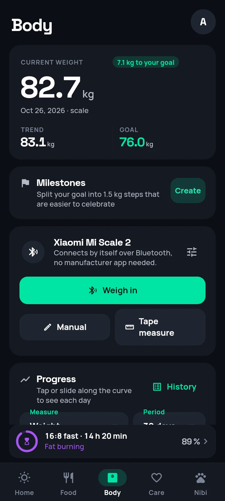 |

| Care | Nibi | Fasting |
|---|---|---|
| 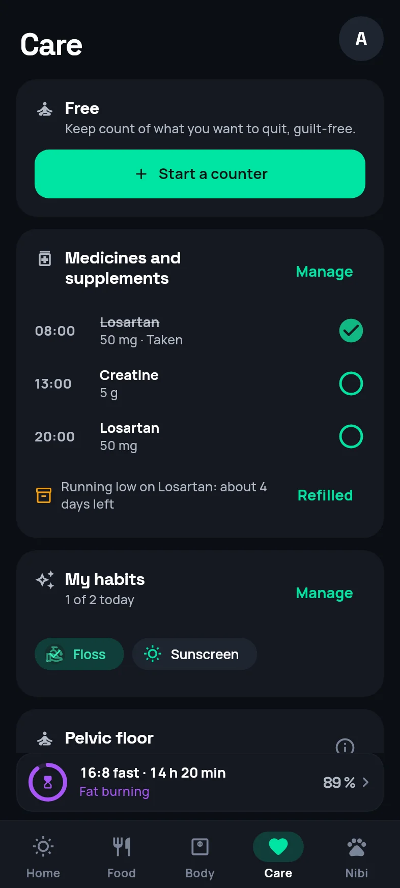 | 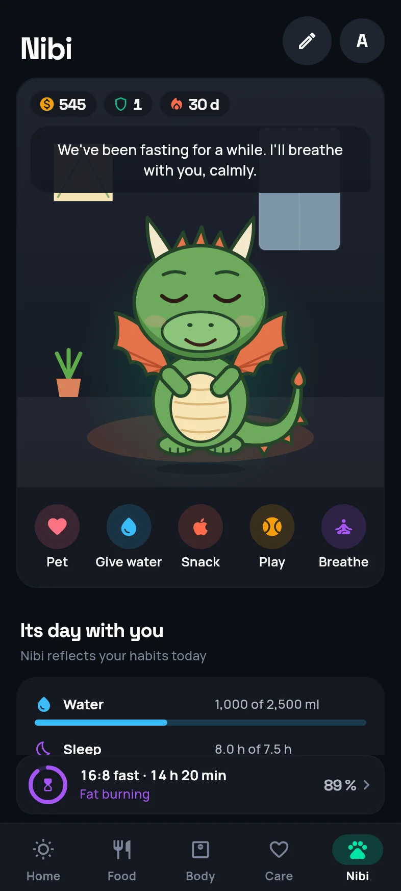 | 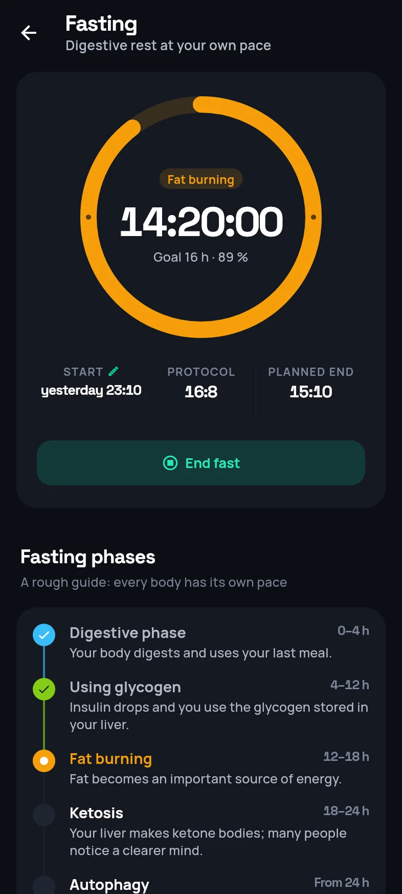 |

| Profile | Paper theme | Settings |
|---|---|---|
| 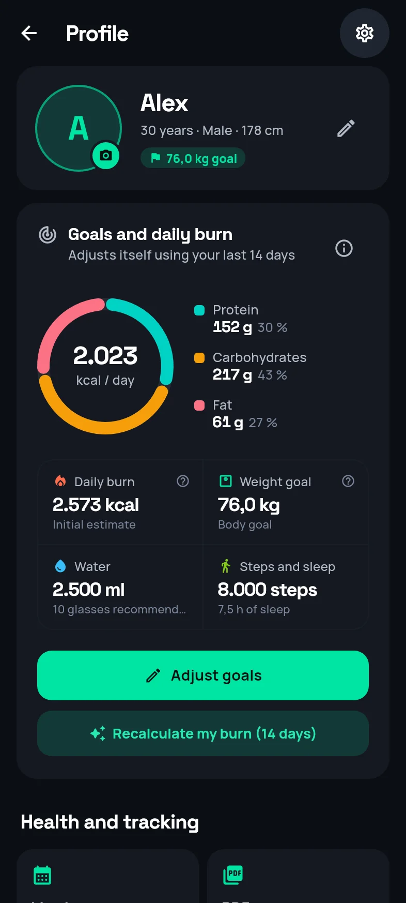 | 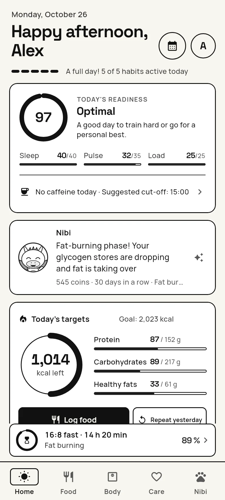 | 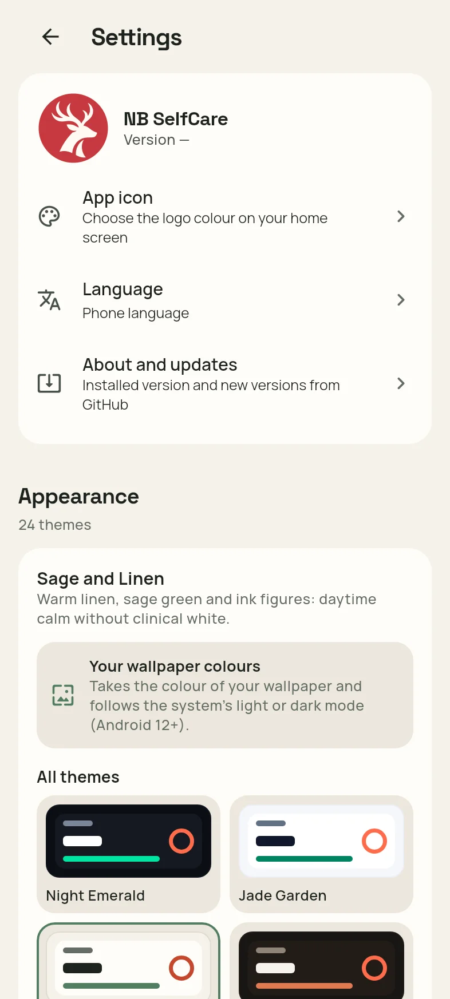 |

The profile, meals, weigh-ins, medicines and records in these images are fictional, created by the app's demo
edition.

## Quick install

Download from the release page and verify against `SHA256SUMS` and its Ed25519 signature `SHA256SUMS.sig` (see
[supply chain](docs/audit/supply-chain.md)).

| Device | Package |
|---|---|
| Most Android phones (64-bit) | `NB-SelfCare-Mobile-1.0.0-arm64-v8a.apk` |
| Older 32-bit Android phones | `NB-SelfCare-Mobile-1.0.0-armeabi-v7a.apk` |
| Android emulators, Intel/AMD Chromebooks | `NB-SelfCare-Mobile-1.0.0-x86_64.apk` |
| Any Android device | `NB-SelfCare-Mobile-1.0.0-universal.apk` |
| iPhone and iPad | `NB-SelfCare-Mobile-1.0.0-ios-unsigned.ipa` (**untested**) |

Android 8.0 or later is the verified platform. Because the app does not come from a store, Android warns before
installing it. The iOS build is published **untested on a real device** and without an Apple signature: you need to
sign it yourself to install it, and iOS will warn about it. Health Connect, scheduled reminders, the lock-screen
fasting timer, guided vibration, the per-theme icon and the in-app updater are Android-only. Reports from iOS are
welcome.

To build from source:

```bash
just setup                                   # dependencies, Drift code and texts
flutter run --dart-define=NB_DEMO=true       # run with the fictional demo profile
just apk
```

Details: [developer setup](docs/developer/setup.md).

## Documentation

| If you want to... | Read |
|---|---|
| Use the application | [User guide](docs/user/README.md) |
| Evaluate it for an institution | [Institution](docs/institution/README.md) |
| Understand how it is built | [Architecture](docs/architecture/README.md) |
| Know why it is built this way | [ADR](docs/adr/README.md) |
| Contribute | [CONTRIBUTING.md](CONTRIBUTING.md) and [developer guide](docs/developer/README.md) |
| Work on it with an AI agent | [AGENTS.md](AGENTS.md) |

## Contributing, security and conduct

Contributions are welcome under the Developer Certificate of Origin (`git commit -s`); see
[CONTRIBUTING.md](CONTRIBUTING.md). Report vulnerabilities privately as described in [SECURITY.md](SECURITY.md).
Participation is governed by the [Code of Conduct](CODE_OF_CONDUCT.md).

## Licence and trademarks

Apache License 2.0; see [LICENSE](LICENSE) and [NOTICE](NOTICE). The names "NB", "NB Digital", "NB SelfCare" and
"NB SelfCare Mobile" and their logos are not licensed under Apache 2.0; see [TRADEMARKS.md](TRADEMARKS.md). To cite
the project, use [CITATION.cff](CITATION.cff).
