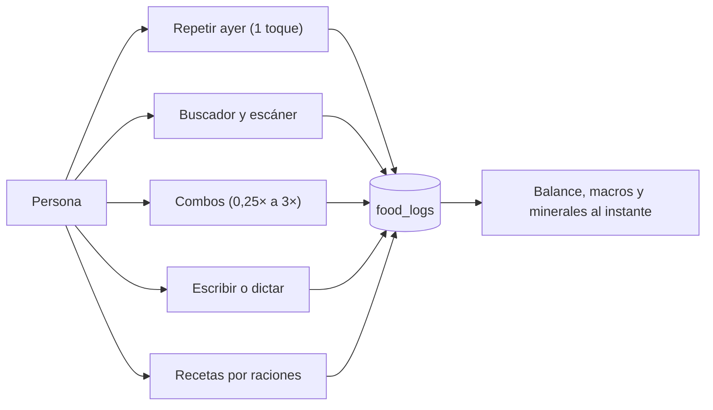

# Nutrición e hidratación

> **Estado:** Implementado.

Registrar comida en menos de quince segundos, con un catálogo local que funciona sin conexión. Código en
`lib/features/nutrition_hydration/`, `lib/core/network/open_food_facts_service.dart` y
`lib/core/services/text_assistant.dart`.

## 1. Caminos de registro

La pantalla Comida pone arriba el buscador (con el escáner a la derecha) y una fila de cinco atajos: escribir
comida, combos, recetas, crear alimento y menú sugerido. Justo después, el balance del día y las comidas.

## 2. Escáner y Open Food Facts

1. **Lectura:** `flutter_zxing` sobre la cámara, limitado a EAN-13, EAN-8, UPC-A y UPC-E
   ([ADR-005](../adr/005-barcode-scanner.md)). Sin permiso de cámara se ofrece abrir Ajustes, escribir el código o
   crear el alimento.
2. **Catálogo local:** si el código ya está, se abre la porción al instante y sin internet.
3. **Open Food Facts:** si no está, se consulta la API pública a través de la puerta de red
   ([ADR-004](../adr/004-network-exit.md)). Se prefiere el nombre del producto en el idioma de la interfaz, todo se
   normaliza a 100 g, se guarda el Nutri-Score y el grado NOVA, y el producto queda en el catálogo para siempre.
4. **Alta a mano:** sin red o sin resultado, se crea el alimento y el código queda asociado.

El buscador consulta primero el catálogo local (FTS5, sin tildes) y ofrece "Buscar en Open Food Facts" solo si la
persona lo toca.

## 3. Semilla de alimentos

Unos 165 alimentos con valores de USDA FoodData Central (por 100 g y con su porción habitual), escritos en el
idioma de la interfaz al crear la base ([almacenamiento](storage.md)): carnes, pescados, huevos, lácteos, frutas,
verduras, legumbres, tubérculos, cereales, semillas, aceites, bebidas y platos habituales.
`test/nutrition/seed_foods_test.dart` comprueba que no haya nombres repetidos y que la energía cuadre con los
macronutrientes.

## 4. Minerales y fibra

Sodio, potasio, magnesio y fibra se muestran con su meta; calcio, hierro, zinc y vitaminas C, D y B12 se guardan.
Un nutriente que la etiqueta no declara es "Dato no reportado", nunca cero
([ADR-015](../adr/015-essential-micronutrients.md)). El grado de procesamiento NOVA resume qué parte de las calorías
del día viene de alimentos poco procesados.

## 5. Combos, recetas y repetir

* **Combos:** agrupan varios alimentos; un deslizador de 0,25× a 3× escala todos a la vez.
* **Recetas:** ingredientes en crudo y número de raciones o peso cocinado; registrar una ración calcula sus macros.
* **Repetir ayer:** cada comida copia lo de ayer a esa misma comida, con Deshacer.
* **Menú sugerido:** porciones al gramo de alimentos del catálogo para cuadrar las calorías del día según el tipo de
  dieta; los términos de búsqueda de cada dieta están en el idioma activo.

## 6. Escribir o dictar

* **Voz:** reconocimiento del teléfono **solo sin conexión**; si no está disponible, el micrófono no aparece.
* **Texto a alimentos:** analizador determinista en español, inglés y portugués ([ADR-010](../adr/010-deterministic-text.md)):
  separa por comas y conectores, reconoce cantidades y unidades, busca cada término en el catálogo y, si no lo
  encuentra, usa valores de respaldo de su categoría. Cantidades absurdas se descartan o acotan.
* Antes de guardar siempre aparece la revisión editable.

## 7. Agua

Botones de 250 y 500 ml en Inicio y Comida y vasos a medida. Cada vaso es un registro con su hora, se exporta a
Health Connect si hay permiso y cumplir la meta da 15 monedas una vez al día.
