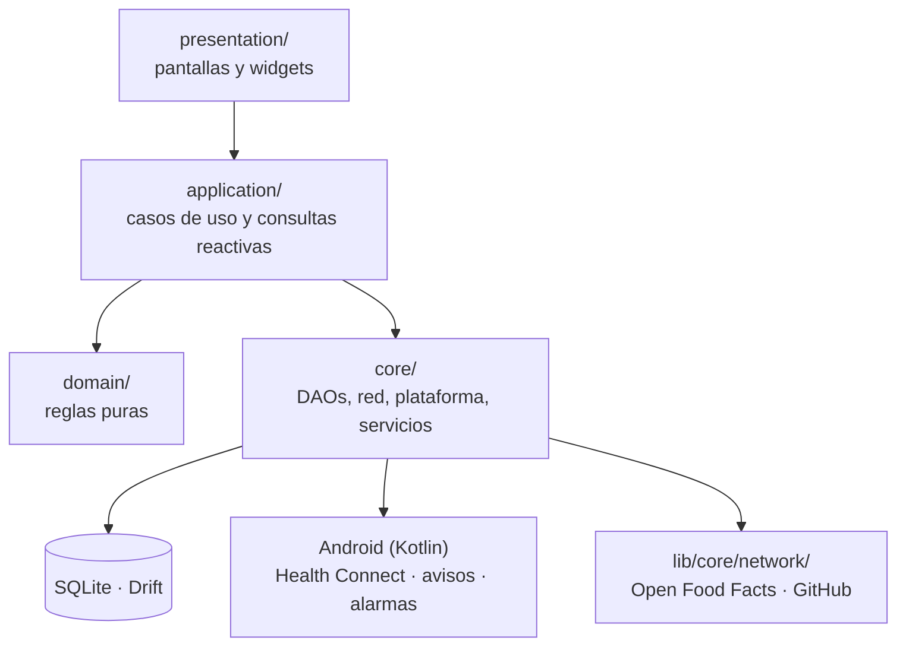

# Visión general

> **Estado:** Implementado.

NB SelfCare Mobile es una app Flutter organizada **por funcionalidad** y, dentro de cada una, **por capas**. El
estado y la inyección de dependencias usan Riverpod 3; la persistencia, Drift sobre SQLite; la navegación,
go_router.

## 1. Capas



| Capa | Contenido | Regla |
|---|---|---|
| `presentation/` | Pantallas, hojas y tarjetas | Lee con *providers* de `application/` y escribe con sus servicios; nunca importa un DAO |
| `application/` | Servicios (`WeighInService`, `FoodLoggingService`, `FastingService`…) y consultas (`todayOverviewProvider`, `nutritionDayProvider`…) | Orquesta transacciones, recompensas y efectos nativos |
| `domain/` | Reglas puras: `RewardPolicy`, `NibiMoodResolver`, `WeighInAnalyzer`, `QuitProgress`… | Sin entrada ni salida; se prueban sin Flutter |
| `core/` | Base de datos y DAOs, puerta de red, puentes de plataforma, idioma, servicios transversales (copia, PDF, analítica, texto) | No depende de `features/` |
| `shared/` | Sistema de diseño (`theme/`), utilidades (fechas, números, fórmulas) y widgets comunes | No depende de `features/` |

## 2. Estructura

```text
lib/
├── main.dart · app.dart          Arranque, tema e idioma
├── app/
│   ├── app_shell.dart            Armazón: barra inferior y barra de ayuno
│   ├── router/app_router.dart    Cinco pestañas y rutas de pantalla completa
│   └── widgets/                  Barra inferior, barra de ayuno, botón de perfil
├── core/
│   ├── clock/                    Clock inyectable: única fuente de la hora
│   ├── constants/                Constantes de la app (nombre, versión, monedas)
│   ├── database/                 tables.dart, app_database.dart (esquema 8), daos/, seeder/
│   ├── domain/                   Enums y reglas compartidas
│   ├── hardware/                 BodyScaleDriver y el driver de la Mi Scale 2
│   ├── l10n/                     ARB (es, en, pt), idioma activo y código generado
│   ├── network/                  La puerta de red: salidas.dart, Open Food Facts, actualizaciones
│   ├── platform/                 Puentes nativos (callNative, bestEffort) y plataforma.dart
│   └── services/                 Copia, PDF, analítica cruzada, cafeína, disposición, texto, menú
├── features/
│   ├── today/                    Inicio: disposición, tablero de tarjetas, domingo
│   ├── nutrition_hydration/      Comida y agua
│   ├── body_metrics/             Báscula, peso, cinta, entrenamientos, metas, ciclo
│   ├── care/                     Cuidado
│   ├── quit/                     Libre
│   ├── fasting/                  Ayuno
│   ├── journal/                  Diario, cafeína y digestión
│   ├── pet_gamification/         Nibi, monedas, tienda y respiración
│   ├── profile_goals/            Perfil, metas, ajustes, recordatorios, idioma
│   └── protocol/                 Protocolo semanal
└── shared/
    ├── theme/                    ScColors, tokens, 24 temas y sus nombres por idioma
    ├── utils/                    Fechas, números, fórmulas biométricas, metas diarias
    └── widgets/                  HealthCard, CardHeader, MetricValue, anillos, barras, hojas
```

## 3. Navegación

Cinco pestañas en un `StatefulShellRoute` (cada una conserva su estado y sus tickers se pausan cuando no está
visible): `/hoy`, `/comer`, `/cuerpo`, `/cuidado` y `/nibi` ([ADR-008](../adr/008-information-architecture.md)).
Sobre el navegador raíz: `/perfil` (desde el avatar de cada cabecera), `/ayuno`, `/protocolo`, `/ajustes`,
`/ajustes/icono`, `/ajustes/acerca`, `/libre`, `/libre/:id`, `/privacidad` (exigida por Health Connect) y
`/onboarding`. Sin perfil, el router redirige a la bienvenida.

## 4. Flujo de datos

1. Las pantallas observan *streams* de Drift combinados en un modelo por pantalla (`TodayOverview`, `NibiOverview`,
   `NutritionDay`…). Cualquier escritura se refleja sola, sin "recargar".
2. Las escrituras con reglas pasan por un caso de uso que abre una transacción. Un pesaje (`WeighInService`):
   - guarda la medición con su peso tendencia y las métricas de bioimpedancia;
   - evalúa la falsa subida (sodio, carbohidratos, agua, fase lútea, creatina) y guarda su explicación en el idioma
     activo;
   - otorga monedas una vez al día (`RewardService` y `RewardPolicy`, con multiplicador de sueño);
   - si tocan los 14 días, recalibra el gasto diario (`TdeeCalibrationService`);
   - fuera de la transacción exporta peso y grasa a Health Connect con `bestEffort`: un fallo nativo nunca deshace
     el registro.
3. La hora sale siempre de `Clock` (`clockProvider`). Los días de calendario usan `addDays` y `calendarDaysSince`,
   seguros ante cambios de horario.
4. Los servicios sin `BuildContext` leen los textos del idioma activo con `l10nProvider` en el momento de usarlos
   ([i18n](i18n.md)).

## 5. Pruebas de arquitectura

`test/qa_audit/architecture_guardrails_test.dart` falla si aparece un SDK de nube o telemetría, un cliente HTTP
fuera de la puerta de red, marcas de trabajo pendiente o código truncado, `dynamic` innecesario en DAOs y fórmulas, `allowBackup`
distinto de `false`, vocabulario de muerte o culpa en Nibi, `DateTime.now()` fuera de `core/clock`, la interfaz
escribiendo sin caso de uso o importando DAOs, o `core/` y `shared/` dependiendo de `features/`.
